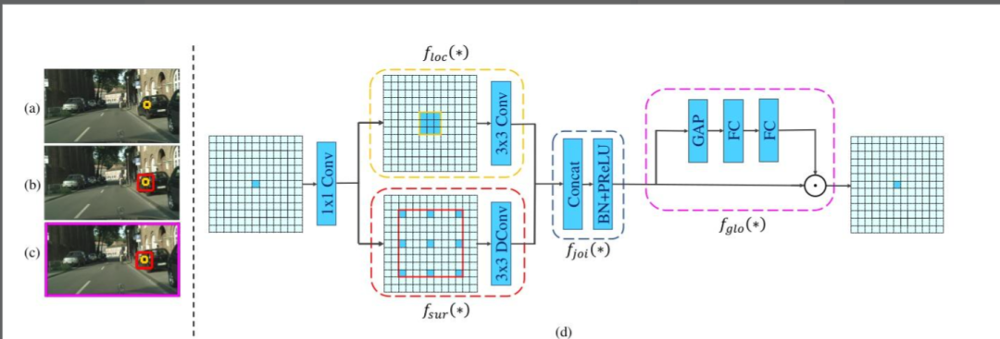
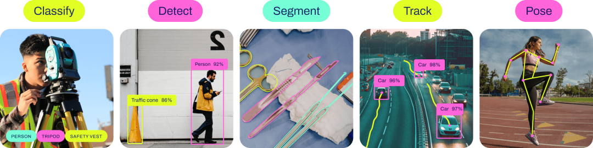
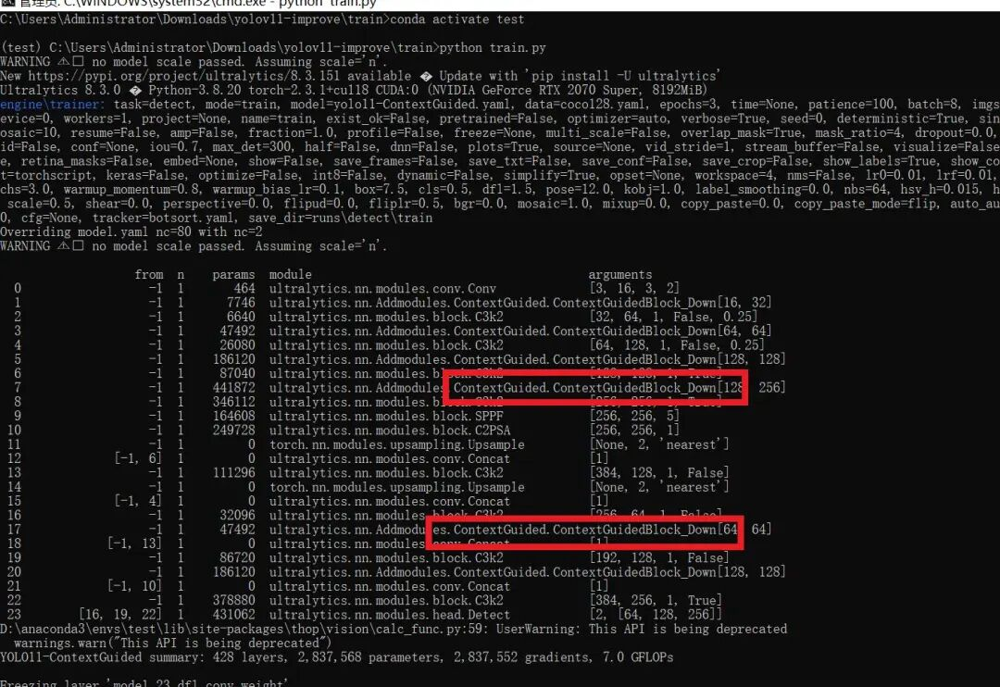

# [yolov11 Improvement Series] Lightweight Downsampling with ContextGuided based on yolov11 in Python source code + training code

[Context-Guided Introduction]

## 1. ContextGuideBlock

### 1.1 Introduction

Abstract: With the rapid growth in demand for applying semantic segmentation models on mobile devices, current state-of-the-art networks are too large in parameters to be suitable for mobile use. Meanwhile, other small memory models follow the principles of classification networks, neglecting the inherent characteristics of semantic segmentation. To address this issue, we propose a lightweight and efficient semantic segmentation network - the Contextual Guide Network (CGNet). This paper introduces the first CG block, which learns joint features of local features and surrounding context through learning, and further improves these joint features with global context. Based on the CG block, we develop CGNet. It captures context information at all stages of the network and is specifically designed to enhance segmentation accuracy. CGNet also meticulously designs to reduce parameter count and save memory footprint. When compared with existing segmentation networks under similar parameter count, CGNet significantly outperforms them.

1.2 Principles of context-guided block-down

The human visual system relies on contextual information to understand scenes. CGBlock captures local features, surrounding context, and global context, and integrates these pieces of information to enhance accuracy. This module consists of the following components:

1.

1. Local feature extractor

(floc): Learning local features using standard convolutional layers

1.

1. Surrounding context extractor

(fsur): Learning context around larger receptive fields using vacuous/dilation convolution layers

1.

1. Joint feature extractor

(fjoi): Utilize connection layers, batch normalization (BN), and parameterized (ReLU/PReLU) operations to integrate local features with contextual surroundings for the acquisition of joint features.

1.

1. Global Context Extractor

(fglo): Utilize a global average pooling layer to aggregate the global context, and then further extract the global context through a multilayer perceptron. Subsequently, use a scaling layer to weight the extracted global context for joint features, highlighting useful components and suppressing unhelpful ones.

This process is adaptive, as the extracted global context is generated based on the input image. The design of CG Block allows CGNet to effectively aggregate context information from the bottom to the top, and capture context information at both the semantic and spatial levels.

(a) FCN-shape (Fully Convolutional Network shape): This model follows the design principles of image classification, ignoring contextual information. It may use a series of convolution and pooling layers to process the input image and generate output, but does not explicitly model the context around the features in each layer.

(b) FCN-CM (Fully Convolutional Network - Contextual Module): This model only captures contextual information after the encoding stage, extracting contextual information from the semantic level through the execution of a contextual module.

(c) CGNet (Contextual Guidance Network): Capturing context features at all stages, from both semantic and spatial levels.

### Local Feature Extractor: flocc(*)

A component of the contextual guidance block (CG block), specifically designed to learn local features within input data. In the design of cgnet, this local feature extractor is implemented through a standard 3x3 convolution layer, with the goal of extracting features from local regions in the image. These local features are then combined with surrounding contextual features, forming a comprehensive understanding of each region by the network, which is particularly important for semantic segmentation.

CGNet employs a local feature extractor in conjunction with a contextual surrounding extractor (fsur(*)) to ensure that the model not only comprehends the information of each pixel or local region but also understands the relationships among these regions within the overall context. This extractor is crucial for capturing the details and local variations that are essential for accurately classifying each pixel in an image, especially in tasks requiring fine-grained predictions, such as distinguishing different objects and surfaces in complex scenes.

The structure design of CGNet also includes reducing the number of parameters, where local feature extractors and contextual feature extractors utilize channel convolutions to reduce cross-channel computation costs and significantly save memory. This design allows CGNet to effectively operate even in resource-constrained environments (such as mobile devices), while maintaining high accuracy and real-time performance.

### Surrounding Context Extractor (fsur(*))

1.

1.

Extract broader context: The Surround Context Extractor uses extended convolutions (e.g., Dilated Convolution) to increase the receptive field size, thereby capturing wider contextual information. This allows the model to observe features in larger regions than just local details.

1.

1.

Auxiliary Local Feature Understanding: By integrating local features with surrounding context, fsur(*) can provide additional information that helps the model better understand complex scenes. For example, in recognizing an object, not only does the object itself provide important clues, but its surrounding environment also offers crucial information.

1.

1.

Improving the Accuracy of Semantic Segmentation: Studies have shown that information from surrounding contexts is very beneficial for enhancing the accuracy of semantic segmentation. In different architecture experiments, introducing fsur(*) can significantly improve the accuracy of segmentation.

1.

1.

Used in all blocks of the network: To fully leverage the advantages of surrounding context, fsur(*) is applied across all blocks of CGNet to ensure that the entire network benefits from the extraction of surrounding context information.

1.

1. Spatial Pyramid Pooling

In some variants, fsur(*) may employ spatial pyramid pooling to aggregate contextual information at different scales, which aids the model in capturing information from the smallest details to the overall layout.

### Joint Feature Extractor fjoi (*)

In CGNet, it serves to integrate features extracted by local feature extractors and contextual feature extractors. These features capture the details of the input data (local features) and information from a broader area (contextual features). The design of the joint feature extractor aims to enable the network to consider both local and contextual information simultaneously, thereby improving the accuracy of semantic segmentation.

1.

1.

Feature fusion: The joint feature extractor combines local features and contextual features around them through the concatenation operation to form a comprehensive feature representation.

1.

1.

Enhanced feature representation: The features after fusion are further processed through operations such as batch normalization and parameterized linear units to enhance the capability of feature representation.

1.

1.

Global context integration: In some designs, the joint features are also combined with global context features to utilize the information of the entire input image for further feature optimization.

The Joint Feature Extractor is a key connection point for the context-guided network to achieve its efficient semantic segmentation capability, which allows the network to achieve a balance between local fineness and global context.

CGNet architecture

Stage 1: Containing a series of 3x3 convolutional layers, which are responsible for extracting preliminary features from the input image.

Stage 2: Composed of multiple CG blocks, denoted by M, each CG block incorporates both local feature extractors and contextual feature extractors. Together, they work to capture more complex local and contextual information.

Stage 3: Inclusion of more CG blocks, represented by N, this stage further refines the features to capture higher-level contextual information.

1*1conv: Number of target categories to which the feature maps are mapped, preparing for final upsampling and classification.

Upsampling: Use upsampling or inverse convolution operation to enlarge the feature map size back to the input image's dimensions.

Prediction: The final prediction map, where each pixel is assigned a category label, displays the result of semantic segmentation on the input image.

Global Context Extractor

In CGNet, it plays the role of capturing and utilizing the global information of the entire input image to enhance the learned features by the joint feature extractor. The basic principle is as follows:

1.

1.

Global Feature Aggregation: The global context extractor aggregates the global information of the entire feature map through global average pooling. This step produces a global feature vector that captures the average response of each channel in the input image.

1.

1. Multilayer Perceptron

Processing: The global feature vector is then further processed by a Multilayer Perceptron (MLP). The MLP can learn complex non-linear relationships between features, further refining the global contextual features.

1.

1.

Feature re-scaling: The extracted global context is combined with the joint features through a scale layer, which acts as a weighting mechanism. This operation involves re-scaling the joint features at the channel level, highlighting the useful parts of the features and suppressing the less important ones.

1.

1.

Adaptive: The operation of the global context extractor is adaptive, as the extracted global context is generated based on the input image, enabling the network to generate customized global contexts for different images.

1.

1.

Improve segmentation accuracy: In ablation studies, the use of global context extractors can enhance segmentation accuracy. This demonstrates the value of global context in improving model performance.

 Edit

[Introduction to YOLOv11 Framework]

On September 30, 2024, Ultralytics officially released YOLOv11 during its event YOLOVision. YOLOv11 is the latest version of YOLO, developed by the team from both the United States and Spain, Ultralytics. YOLO stands for You Only Look Once, a computer vision algorithm used in image-based artificial intelligence.

### Ultralytics YOLO11 Overview

YOLO11 is the latest version of the Ultralytics YOLO series of real-time object detectors, redefining possibilities with cutting-edge precision, speed, and efficiency. Building on impressive advancements from previous YOLO versions, YOLO11 introduces significant improvements in architecture and training methods, making it a versatile choice for various computer vision tasks.


Editor

Key Features

-

-

Enhanced feature extraction: YOLO11 employs an improved backbone and neck architecture, enhancing feature extraction capabilities to achieve more precise object detection and complex task performance.

-

-

Optimization for efficiency and speed: YOLO11 introduces refined architecture design and optimized training pipelines, providing faster processing speeds while maintaining the best balance between accuracy and performance.

-

-

Achieving higher accuracy with fewer parameters: With the advancement of model design, YOLOv11m has achieved higher average precision (mAP) on the COCO dataset while using 22% fewer parameters than YOLOv8m, thereby improving computational efficiency without compromising accuracy.

-

-

Cross-environment adaptability: YOLO11 can be seamlessly deployed in various environments, including edge devices, cloud platforms, and systems supporting NVIDIA GPUs, ensuring maximum flexibility.

-

-

Supports a wide range of tasks: whether it's object detection, instance segmentation, image classification, pose estimation, or Oriented Object Detection (OBB), YOLO11 aims to tackle various computer vision challenges.

 Edit

#### Compared to previous versions, what are the key improvements in Ultralytics YOLO11?

Ultralytics YOLO11 introduces several significant improvements compared to its predecessor. The main improvements include:

-

-

Enhanced feature extraction: YOLO11 employs an improved backbone and neck architecture, enhancing feature extraction capabilities to achieve more precise object detection.

-

-

Optimized efficiency and speed: Precise architectural design and optimized training pipelines provide faster processing speeds while maintaining a balance between accuracy and performance.

-

-

Achieving higher accuracy with fewer parameters: YOLOv11m achieves higher average precision (mAP) on the COCO dataset, reducing its parameters by 22% compared to YOLOv8m, while improving computational efficiency without compromising accuracy.

-

-

Cross-environment adaptability: YOLO11 can be deployed across various environments, including edge devices, cloud platforms, and systems supporting NVIDIA GPUs.

-

-

Supports a wide range of tasks: YOLO11 supports various computer vision tasks, such as object detection, instance segmentation, image classification, pose estimation, and Oriented Object Detection (OBB).

[Test Environment]

windows10 x64

ultralytics==8.3.0

torch==2.3.1

[Improvement Process]

1. Add a new module called `ContextGuided.py` to implement the functionality (the code is too extensive, please refer to the improvement steps in the docx file for the core module source code). Then create a `__init__.py` file under the same directory and write the code.

from .ContextGuided import *

#### 2. File modification steps

**Modify tasks.py file**

**Create Model Configuration File**

The content of yolo11-ContextGuided.yaml is as follows:

```
# Ultralytics YOLO 🚀, AGPL-3.0 license
# YOLO11 object detection model with P3-P5 outputs. For Usage examples see https://docs.ultralytics.com/tasks/detect
# Parameters
nc: 80 # number of classes
scales: # model compound scaling constants, i.e. 'model=yolo11n.yaml' will call yolo11.yaml with scale 'n'
  # [depth, width, max_channels]
  n: [0.50, 0.25, 1024] # summary: 319 layers, 2624080 parameters, 2624064 gradients, 6.6 GFLOPs
  s: [0.50, 0.50, 1024] # summary: 319 layers, 9458752 parameters, 9458736 gradients, 21.7 GFLOPs
  m: [0.50, 1.00, 512] # summary: 409 layers, 20114688 parameters, 20114672 gradients, 68.5 GFLOPs
  l: [1.00, 1.00, 512] # summary: 631 layers, 25372160 parameters, 25372144 gradients, 87.6 GFLOPs
  x: [1.00, 1.50, 512] # summary: 631 layers, 56966176 parameters, 56966160 gradients, 196.0 GFLOPs
# YOLO11n backbone
backbone:
  # [from, repeats, module, args]
  - [-1, 1, Conv, [64, 3, 2]] # 0-P1/2
  - [-1, 1, ContextGuidedBlock_Down, [128]] # 1-P2/4
  - [-1, 2, C3k2, [256, False, 0.25]]
  - [-1, 1, ContextGuidedBlock_Down, [256]] # 3-P3/8
  - [-1, 2, C3k2, [512, False, 0.25]]
  - [-1, 1, ContextGuidedBlock_Down, [512]] # 5-P4/16
  - [-1, 2, C3k2, [512, True]]
  - [-1, 1, ContextGuidedBlock_Down, [1024]] # 7-P5/32
  - [-1, 2, C3k2, [1024, True]]
  - [-1, 1, SPPF, [1024, 5]] # 9
  - [-1, 2, C2PSA, [1024]] # 10
# YOLO11n head
head:
  - [-1, 1, nn.Upsample, [None, 2, "nearest"]]
  - [[-1, 6], 1, Concat, [1]] # cat backbone P4
  - [-1, 2, C3k2, [512, False]] # 13
  - [-1, 1, nn.Upsample, [None, 2, "nearest"]]
  - [[-1, 4], 1, Concat, [1]] # cat backbone P3
  - [-1, 2, C3k2, [256, False]] # 16 (P3/8-small)
  - [-1, 1, ContextGuidedBlock_Down, [256]]
  - [[-1, 13], 1, Concat, [1]] # cat head P4
  - [-1, 2, C3k2, [512, False]] # 19 (P4/16-medium)
  - [-1, 1, ContextGuidedBlock_Down, [512]]
  - [[-1, 10], 1, Concat, [1]] # cat head P5
  - [-1, 2, C3k2, [1024, True]] # 22 (P5/32-large)
  - [[16, 19, 22], 1, Detect, [nc]] # Detect(P3, P4, P5)

```

#### 3. Verification of integration

Search for the source code of futureflsl/yolo-improve using Git, then use the newly created yaml configuration file to start the training task:

```
from ultralytics import YOLO
if __name__ == '__main__':
    model = YOLO('yolo11-ContextGuided.yaml')  # build from YAML and transfer weights
        # Train the model
    results = model.train(data='coco128.yaml',epochs=100, imgsz=640, batch=8, device=0, workers=1, save=True,resume=False)
```

After successful integration, the training log will show the initialization information of the ContextGuided module, indicating that it has been correctly loaded into the model.

 Editor

[Training Instructions]

Step 1: First, install the necessary modules for YOLOv11. You can refer to the installation process of the YOLOv11 framework. Then, uninstall the official version of pip by running `pip uninstall ultralytics`. Finally, install the improved source code by running `pip install .`
Step 2: Place your dataset in a folder named 'dataset' and ensure that the folder names remain unchanged.
Step 3: Open the train.py, coco128.yaml, and model parameters yaml files separately and modify the necessary parameters. Finally, execute `python train.py` to train.

[Provided Files]

```
├── [Official Source Code]ultralytics-8.3.0.zip
├── train/
│   ├── coco128.yaml
│   ├── dataset/
│   │   ├── train/
│   │   │   ├── images/
│   │   │   │   ├── firc_pic_1.jpg
│   │   │   │   ├── firc_pic_10.jpg
│   │   │   │   ├── firc_pic_11.jpg
│   │   │   │   ├── firc_pic_12.jpg
│   │   │   │   ├── firc_pic_13.jpg
│   │   │   ├── labels/
│   │   │   │   ├── classes.txt
│   │   │   │   ├── firc_pic_1.txt
│   │   │   │   ├── firc_pic_10.txt
│   │   │   │   ├── firc_pic_11.txt
│   │   │   │   ├── firc_pic_12.txt
│   │   │   │   ├── firc_pic_13.txt
│   │   └── val/
│   │       ├── images/
│   │       │   ├── firc_pic_100.jpg
│   │       │   ├── firc_pic_81.jpg
│   │       │   ├── firc_pic_82.jpg
│   │       │   ├── firc_pic_83.jpg
│   │       │   ├── firc_pic_84.jpg
│   │       ├── labels/
│   │       │   ├── firc_pic_100.txt
│   │       │   ├── firc_pic_81.txt
│   │       │   ├── firc_pic_82.txt
│   │       │   ├── firc_pic_83.txt
│   │       │   ├── firc_pic_84.txt
│   ├── train.py
│   ├── yolo11-ContextGuided.yaml
└── training_notes.txt
├── [Improved Source Code]ultralytics-8.3.0.zip
├── Improvement Principles.docx
└── Improved Process.docx
```

[Common Issues Summary]
Question: Why does the map of my model's epoch display as 0 or have very low accuracy?
Answer: Due to the source code being improved, it is not possible to directly fine-tune from the official model. Instead, training from scratch is required, which will result in weaker learning of features and requires many epochs for effects to emerge. Moreover, since the improved source code framework may not necessarily guarantee surpassing the official accuracy, there is also a possibility of achieving far worse results or even very low precision. This indicates that the improved framework does not yield good results. Therefore, for framework improvements, it merely provides a viable solution. Whether the improvements can lead to excellent performance still needs to be confirmed based on actual training conditions. Of course, this does not rule out the possibility of dataset issues, such as a single dataset, unbalanced sample distribution, limited generalization scenarios, poor annotation quality, and small detection targets among other reasons.
[Important Notice]
We only offer one improvement framework solution, and we do not guarantee that it will achieve excellent training accuracy or even surpass the accuracy of official models. The improvement framework is actually a complex process including the feasibility of the framework principle, whether the training dataset is appropriate, the need for back-propagation validation, as well as the comparison of parameter results from similar frameworks. This is a very complex and lengthy process.


## Payment

Here is a pay link on Stripe ( https://buy.stripe.com/3cs8yP7sY87d0vu9AB ). Please contact me lonlonago@foxmail.com after funding $89, and I will send you a complete data files , thank you!


